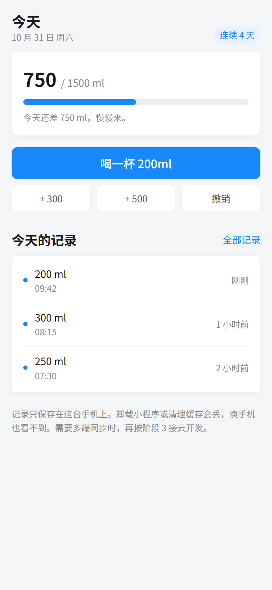
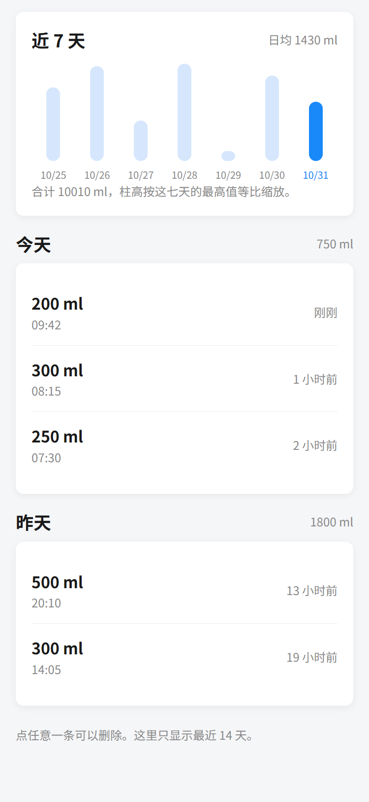

# 示例项目 · 喝水记录

> 三页、能跑、零依赖、不接云开发。**它是「做完应该长什么样」的标准，不是模板。**
> 用户问「这样算做完了吗」，打开它对照。



<sub>上面这张是按示例自带的 `code/app.wxss` 原样渲染的，尺寸与真机接近；真机上字体会有细微差别。</sub>

---

## 怎么打开

1. 打开微信开发者工具 → **导入项目**
2. 目录选这个文件夹里的 `code/`（**不是** `09-示例-喝水记录/`）
3. AppID 选「测试号」（`code/project.config.json` 里已经写了 `touristappid`）
4. 点确定，直接就能跑

不需要 `npm install`，不需要开通云开发，不需要 AppID。

---

## 三页在做什么

| 页面 | 内容 | 对应阶段 2 的哪个模式 |
|---|---|---|
| `code/pages/index` 今天 | 今日总量 + 进度条 + 一个主按钮 + 最近三条 | 工具型首页 + 空态 |
| `code/pages/history` 记录 | 近 7 天柱状图 + 按天分组列表 + 点按删除 | 记录/订单列表（状态分段） |
| `code/pages/mine` 我的 | 目标 slider + 开关 + 危险操作 + 关于 | 个人中心 + 表单行 |

三页加起来 500 行左右，其中一半是注释。



---

## 值得抄的五个地方

### 1. `code/app.wxss` 顶部：token 块

字号只用了 6 档（`t-display` 到 `t-mini`），间距只用 4 的倍数，圆角只有三档。
**没有一处 `var(--x)`**，全是字面值 —— 这是 WXSS 的硬约束，不是风格选择。

### 2. `code/pages/index/index.wxml`：一屏只有一个主按钮

```
主按钮：喝一杯 200ml（蓝色、88rpx 高、整行）
次要：+300 / +500 / 撤销（白底描边、72rpx）
```

用户不用想「点哪个」。如果三个按钮一样重，他每次都要犹豫一次。

### 3. `code/pages/index/index.wxml`：空态

```html
<view class="card empty" wx:if="{{recent.length === 0}}">
  <view class="empty-title">还没有记录</view>
  <view class="t-caption">点上面那个按钮，喝第一杯。</view>
</view>
```

空态要**说下一步做什么**，不是只写「暂无数据」。后者等于告诉用户「这里坏了」。

### 4. `code/utils/store.js`：数据层单独一个文件

页面里没有一句 `wx.getStorageSync`。好处是换存储方式时只改一个文件
（见下面「怎么换成云开发」），而且日期分组、连续天数这些逻辑只有一份实现。

### 5. `code/pages/history/history.js`：删除要二次确认

点一条 → 弹操作菜单 → 选「删除」→ 再弹一次确认。
多一步很烦，但删错数据更烦。破坏性操作的标准做法。

---

## 它故意没做的三件事

| 没做 | 为什么 |
|---|---|
| 登录 / 用户体系 | 示例一旦加登录，你打开就得先授权，挡住你所有页面的验收。**真实项目也应该先做免登录版本** |
| 云开发同步 | 要开通环境、填环境 ID，别人拿到就跑不起来。示例优先保证「打开就能看」 |
| 订阅消息提醒 | 开关留了，但没接模板。真实订阅消息要申请模板 ID，且用户每次授权只能推一条，做半套比不做更误导 |

这三件都在阶段 3 和阶段 6 有专门的步骤，不在示例里解决。

---

## 怎么换成云开发

只改 `code/utils/store.js` 里这几个函数的内部实现，**页面代码一行都不用动**：

| 函数 | 本地存储版 | 云开发版 |
|---|---|---|
| `readAll` | `wx.getStorageSync` | 云函数 `list` 或 `db.collection('records').get()` |
| `add` | 数组 unshift | `db.collection('records').add({ amount, at: Date.now() })` |
| `remove` | filter 后写回 | `db.collection('records').doc(id).remove()` |
| `clear` | `removeStorageSync` | 循环删或云函数批量删 |
| `getGoal` / `setGoal` | storage | 用户表里存一个字段 |

注意三件事（`05-红线/技术红线.md` 有详细根因）：

- 集合权限默认是「仅创建者可读写」，别人看不到你的数据是正常的
- 时间统一存 `Date.now()` 毫秒数，不要存字符串，否则按天分组要额外解析
- 云函数默认 3 秒超时，批量操作要调到 20 秒

---

## 一条提醒

**不要直接在这个文件夹里改成你的项目。**

复制 `code/` 到你自己的工作目录，再改。示例保持原样，下次你（或别人）还能拿它对照。
`AGENTS.md` 里也是这么要求的：它是参照物，不是起点。

---

## 免责

这个示例只做喝水记录，不构成任何医疗或健康建议。
每天喝多少水因人而异，有疾病请听医生的。
